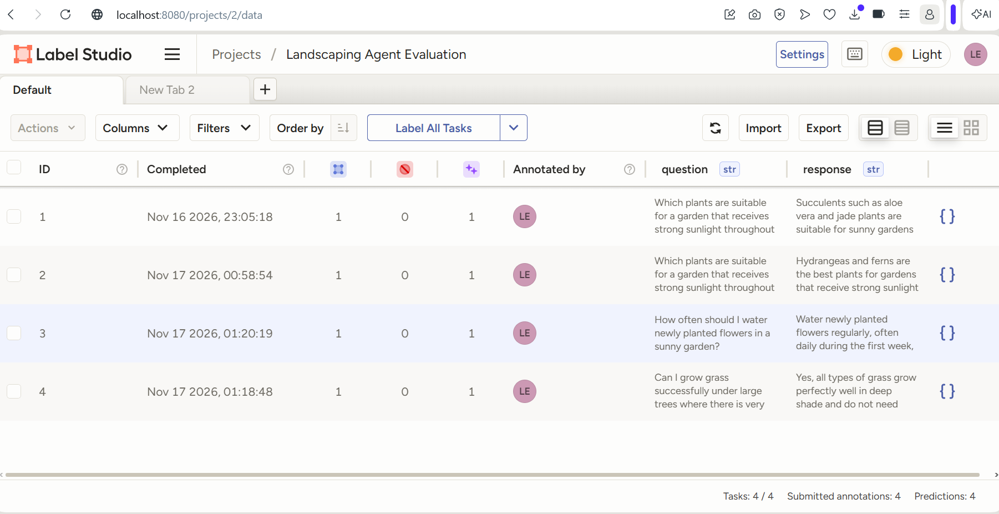
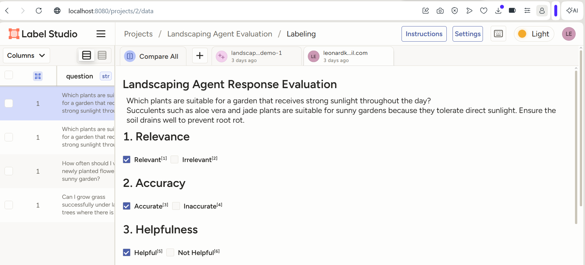
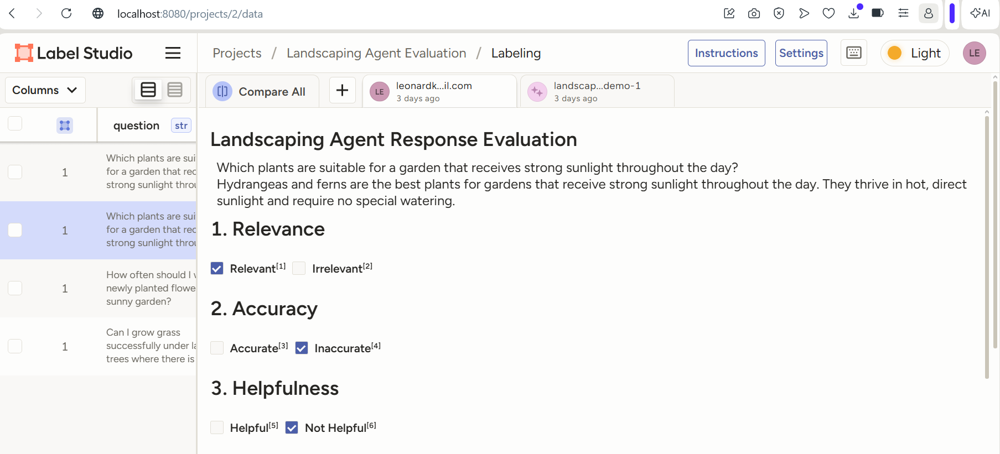
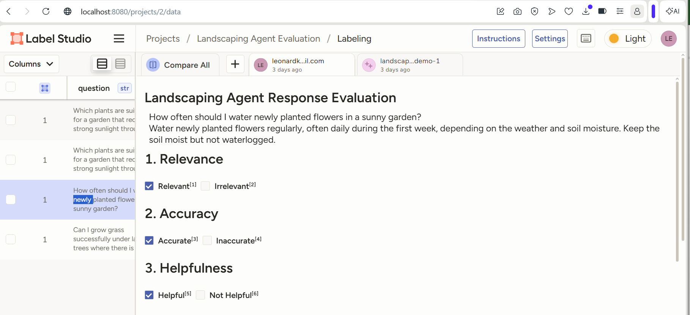
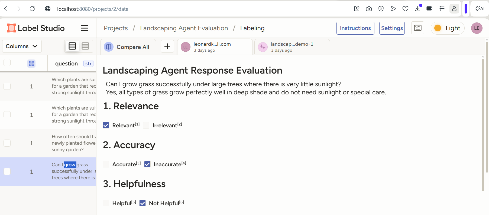

# Landscaping and Horticulture – AI Response Evaluation

## Project Overview

This project involved evaluating AI-generated gardening and landscaping recommendations using Label Studio.

The objective was to assess whether AI-generated advice was relevant, factually accurate, and helpful.

## Evaluation Criteria

- Relevance
- Factual Accuracy
- Helpfulness

## Work Performed

- Evaluated AI-generated plant recommendations against sunlight requirements.
- Identified misleading advice about plant suitability in full-sun environments.
- Assessed recommendations on watering newly planted flowers.
- Identified inaccurate claims about grass growth in deeply shaded environments.
- Applied structured evaluation labels to assess response quality.

## Tools Used

- Label Studio
- Structured data annotation
- AI response evaluation

## Project Screenshots

### Project Overview

### Task 1 – Plant Recommendations

### Task 2 – Plant Recommendations

### Task 3 – Watering Recommendations

### Task 4 – Grass Growth in Deep Shade

