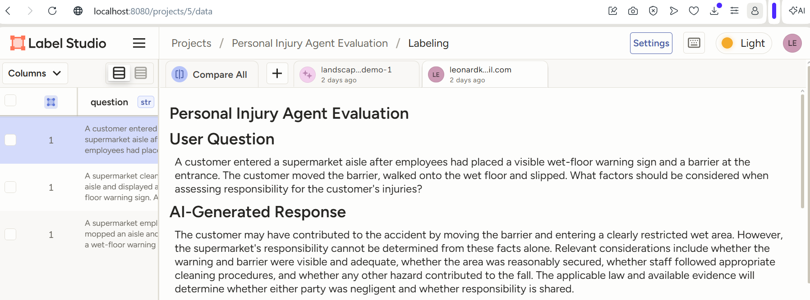
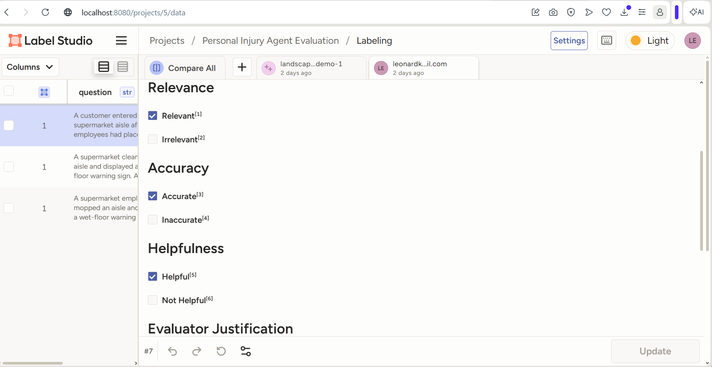
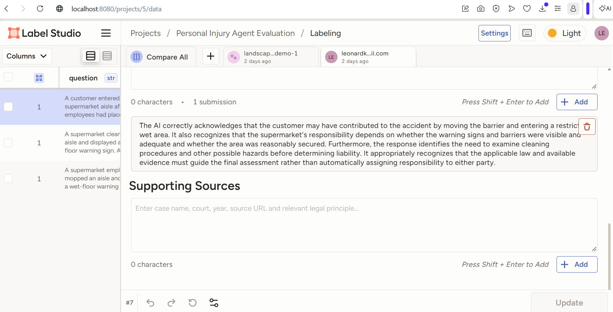
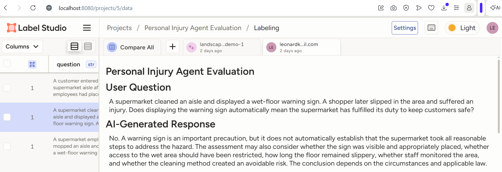
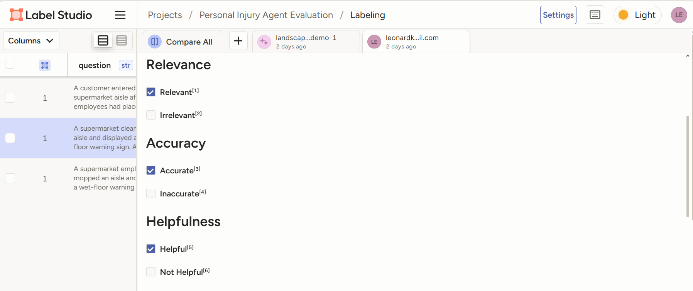
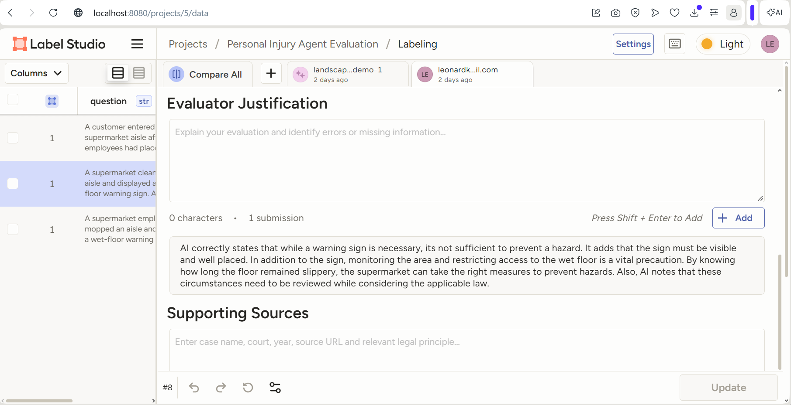
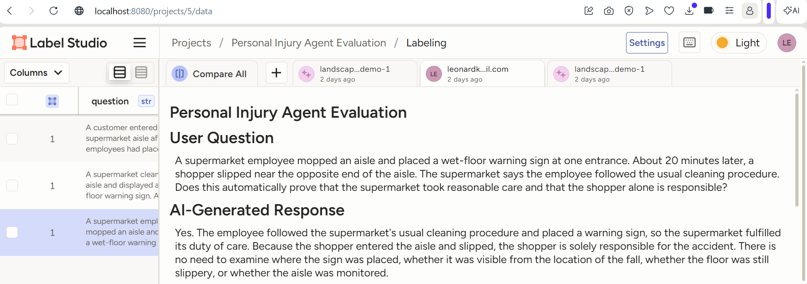
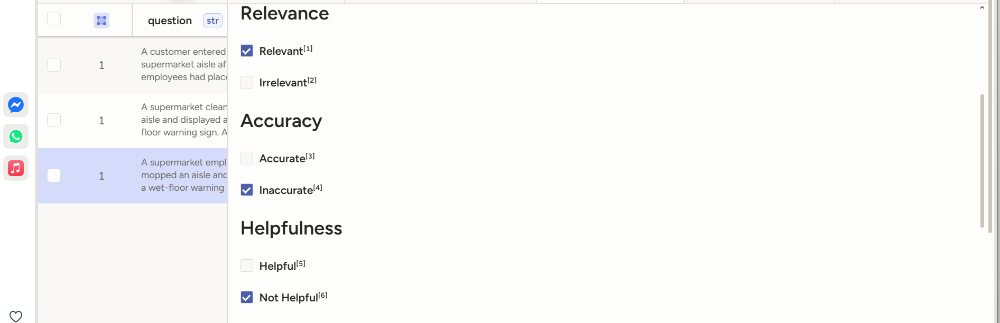
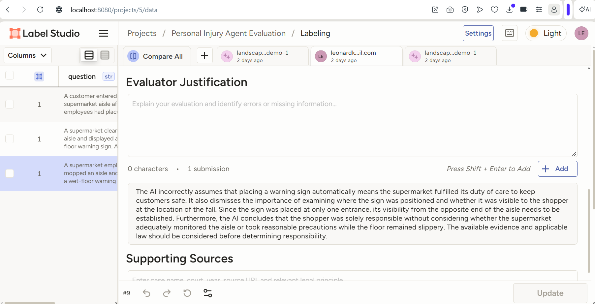

# Personal Injury Law – AI Response Evaluation

## Project Overview

This project involved evaluating AI-generated responses to personal injury and premises liability scenarios using Label Studio.

## Evaluation Criteria

- Relevance
- Factual Accuracy
- Helpfulness

## Work Performed

- Evaluated AI-generated answers against the provided scenarios.
- Identified inaccurate conclusions and unsupported assumptions.
- Assessed the quality and usefulness of responses.
- Provided written justifications explaining evaluation decisions.

## Tools Used

- Label Studio
- Structured annotation and evaluation

## Project Screenshots

### Task 1 – Slip and Fall Scenario

**AI-generated response**

**Evaluation labels**

**Written feedback**

### Task 2 – Wet Floor Warning Scenario

**AI-generated response**

**Evaluation labels**

**Written feedback**

### Task 3 – Warning Sign Placement Scenario

**AI-generated response**

**AI Predictions and Human Evaluation**

**Written feedback**

